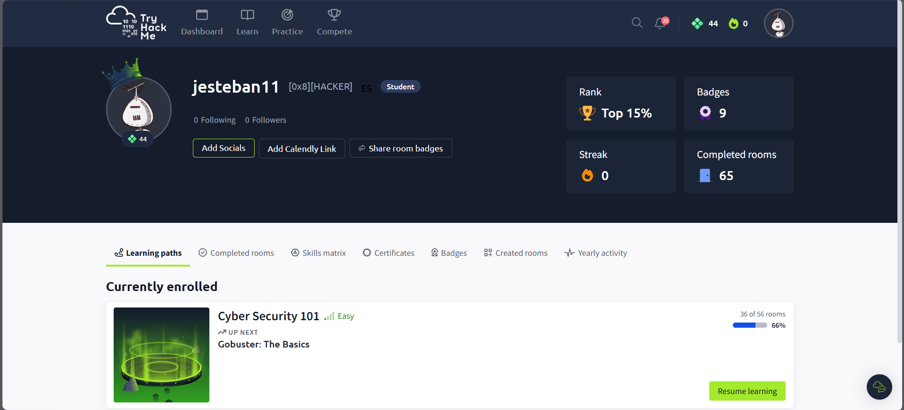
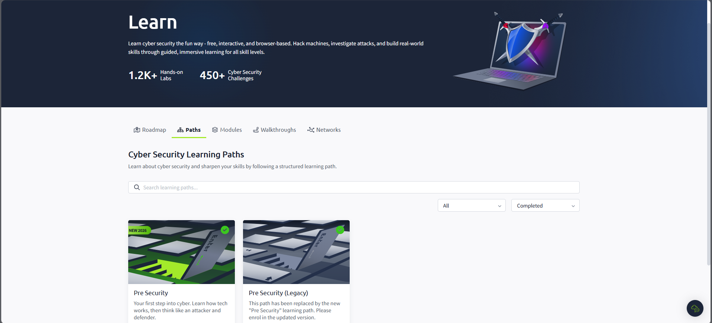

# TryHackMe write-ups

Notes from the TryHackMe paths I've completed: what each room covered and the commands I used.

## Profile

- Username: jesteban11
- Pre-Security path: 100%
- Cybersecurity 101 path: 100%, completed on 15 April 2026 (45 hours 23 minutes)

## Completed paths

## Write-ups

### Pre-Security

| Room | Difficulty | Category | Date |
|---|---|---|---|
| [Network Fundamentals](pre-security/network-fundamentals.md) | Easy | Networking | Apr 2026 |
| [Linux Fundamentals](pre-security/linux-fundamentals.md) | Easy | Linux | Apr 2026 |

### Cybersecurity 101

| Room | Difficulty | Category | Date |
|---|---|---|---|
| [Intro to Offensive Security](cybersecurity-101/intro-offensive-security.md) | Easy | Offensive | Apr 2026 |

## Next

- [ ] Jr Penetration Tester
- [ ] SOC Level 1

## Tools used across rooms

Nmap · Gobuster · Burp Suite · Netcat · Hydra · Wireshark · Metasploit · Linux command line · Python

Juan Esteban Umaña Machado · linkedin.com/in/juanesumaa11
